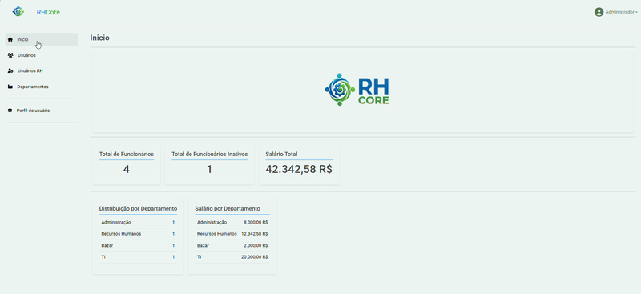

# Apresentação do Sistema | RH Core



RH Core é uma aplicação web para gerenciamento de recursos humanos. O sistema possui áreas específicas para administradores, profissionais de RH e colaboradores, permitindo administrar usuários, departamentos e dados cadastrais.

## Tecnologias utilizadas

- PHP 8.3
- Laravel 13
- Laravel Fortify
- Blade
- Bootstrap 5
- JavaScript
- Font Awesome
- DataTables
- SQLite ou MySQL 8
- Composer
- Docker, Docker Compose e Nginx
- PHPUnit
- MailHog

## Pré-requisitos

Para executar sem Docker:

- PHP 8.3 ou superior
- Composer
- SQLite ou MySQL

Para executar com Docker:

- Docker
- Docker Compose

## Funcionalidades

- Login, logout e recuperação de senha com Laravel Fortify.
- Perfis de acesso para administrador, RH e colaborador.
- Administração de departamentos.
- Cadastro, edição, consulta, exclusão lógica e restauração de colaboradores.
- Cadastro de usuários do setor de RH.
- Confirmação de conta por e-mail e definição da primeira senha.
- Atualização de dados pessoais, endereço e senha no perfil.
- Interface responsiva com componentes Bootstrap.
- Menu lateral por perfil de acesso e dropdown do usuário no cabeçalho.

## Técnicas aplicadas

- Arquitetura MVC do Laravel.
- Eloquent ORM e relacionamentos entre usuários, detalhes e departamentos.
- Migrations e seeders para estrutura e dados iniciais.
- Soft deletes para exclusão recuperável de registros.
- Gates para controle de acesso por função.
- Validação de formulários no servidor.
- Proteção CSRF e autenticação baseada em sessões.
- Blade components e templates reutilizáveis.
- Testes com PHPUnit.

## Configuração do banco de dados


###  MySQL com Docker

Configurar as variáveis do banco no `.env` antes de iniciar os containers:

```env
DB_CONNECTION=mysql
DB_HOST=db
DB_PORT=3306
DB_DATABASE=rh_core
DB_USERNAME=rh_core
DB_PASSWORD=sua_senha
```

> O Docker está configurado com a porta `3307`, validar antes de excutar e usar na porta `db:3306`.

## Executando localmente

Instale as dependências:

```bash
composer install
npm install
```

Prepare o ambiente e o banco:

```bash
cp .env.example .env
touch database/database.sqlite
php artisan key:generate
php artisan migrate
php artisan db:seed
```

Inicie o servidor de desenvolvimento:

```bash
php artisan serve
```

Em outro terminal, execute também:

```bash
npm run dev
```

Acesse `http://127.0.0.1:8000`.

## Executando com Docker

Depois de configurar o banco no `.env`, execute:

```bash
docker compose up -d --build
docker compose exec app php artisan key:generate
docker compose exec app php artisan migrate --seed
```

A aplicação estará disponível em `http://localhost:8080`.

MailHog estará disponível em `http://localhost:8025`.

## Configuração de e-mail

Para desenvolvimento local com o Docker, configure no `.env`:

```env
MAIL_MAILER=smtp
MAIL_HOST=mailhog
MAIL_PORT=1025
MAIL_USERNAME=null
MAIL_PASSWORD=null
MAIL_FROM_ADDRESS="noreply@rhcore.local"
MAIL_FROM_NAME="${APP_NAME}"
```

Sem Docker, o `.env.example` usa `MAIL_MAILER=log`, e os e-mails são registrados no log da aplicação.

## Comandos úteis

```bash
php artisan migrate
php artisan migrate:fresh --seed
php artisan db:seed
php artisan test
npm run build
php artisan route:list
docker compose up -d
docker compose down
```
